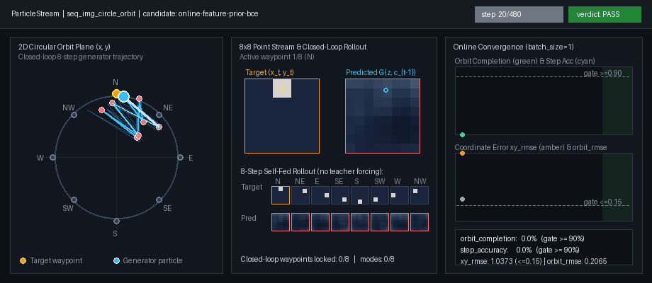
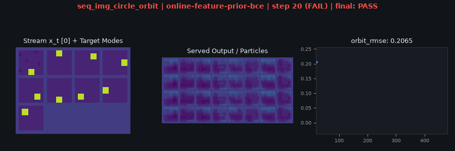

# ParticleStream


[](pyproject.toml)
[](pyproject.toml)
[](pyproject.toml)
[](reports/forge/technique-inventory.md)

**ParticleStream** is a strict online (`batch_size=1`, zero replay) sequential generative modeling and short-horizon world-model memory benchmark built on [`particlegan`](https://pypi.org/project/particlegan/) and `particlegan_forge`.

Instead of training on shuffled i.i.d. minibatches or replay buffers, a ParticleStream learner observes a chronological stream **one frame at a time** (`batch_size=1` for both real and fake optimizer batches), serves a live prediction *before* the next observation arrives, and updates once from that single arrival using detached recurrent state.

- **Single generated leaderboard**: [`reports/forge/technique-inventory.md`](reports/forge/technique-inventory.md)
- **Declared task contracts**: [`reports/forge/EXPERIMENTS_BY_TIER.md`](reports/forge/EXPERIMENTS_BY_TIER.md)
- **Compiled receipt digest**: [`reports/forge/EXPERIMENT_MEMORY.md`](reports/forge/EXPERIMENT_MEMORY.md)
- **Detailed analysis & history**: [`reports/forge/research-notes.md`](reports/forge/research-notes.md) · [`EXPERIMENTATION.md`](EXPERIMENTATION.md) · [`RESEARCH_GLOSSARY.md`](RESEARCH_GLOSSARY.md)

---

## Real-Time Circular Orbit Learning (`seq_img_circle_orbit`)

To see what ParticleStream does at a glance, consider a point particle learning to draw a circle in real time (`seq_img_circle_orbit`):

1. **Stream (`batch_size=1`)**: At each chronological step $t$, the environment emits a single $8\times 8$ frame containing the next point $(x_t, y_t)$ along an 8-waypoint clockwise circular orbit ($\text{N} \to \text{NE} \to \text{E} \to \text{SE} \to \text{S} \to \text{SW} \to \text{W} \to \text{NW}$).
2. **Predict Before Arrival**: Before frame $x_t$ is revealed, `OnlineSession.predict()` draws a next-point prediction from the generator conditioned on the detached causal memory state $c_{t-1}$.
3. **Single-Arrival Update**: Once $x_t$ arrives, `OnlineSession.observe(x_t)` performs exactly one critic/generator update (`real_batch=1`, `fake_batch=1`, `replayed_examples=0`) and advances the causal memory state to $c_t$.
4. **Closed-Loop 8-Step Rollout Gate**: At each of the 24 evaluation checkpoints (`steps 20, 40, ..., 480`), all 32 particles are warm-started with two preceding waypoints and rolled out for **8 consecutive steps in closed loop without teacher forcing** (feeding each particle's own generated frame back into a cloned memory state).



| Metric | Gate | `online-feature-prior-bce` (Terminal Window `400..480`) | What It Verifies |
| --- | --- | --- | --- |
| `orbit_completion` | `>= 0.90` | **`1.0000`** (`100%` of particles) | Complete 8-step closed-loop revolution without teacher forcing |
| `step_accuracy` | `>= 0.90` | **`1.0000`** (`100%` of steps) | Per-step nearest-waypoint classification + quality (`RMSE <= 0.12`) |
| `waypoint_modes` | `== 8.0` | **`8.0`** (`8/8` waypoints) | Full coverage of all 8 orbital phases (`N, NE, E, SE, S, SW, W, NW`) |
| `xy_rmse` | `<= 0.15` | **`0.0036 .. 0.0044`** | 2D coordinate error in normalized $(x, y) \in [-1, 1]^2$ orbit space |
| `orbit_rmse` | `<= 0.12` | **`0.0126 .. 0.0134`** | Pixel-space $8\times 8$ rollout RMSE across all 8 steps |

Standard Forge 24-checkpoint evaluation strip for `seq_img_circle_orbit`:



---

## Install & Quickstart

Activate the project environment (with `particlegan==0.9.7` installed) and install `particlestream` in editable mode:

```bash
pip install -e .
```

### Validate, Run, and Reproduce Qualification

```bash
# Sync Tier 1 task, view, and candidate declarations into configs/forge/
particlestream bootstrap

# Validate all 9 tasks, views, and 44 candidates without launching training
particlestream validate

# Run the qualifying global recipe across all 9 required Tier 1 tasks
particlestream run online-feature-prior-bce --device cuda

# Run the full test suite (oracle/destructive controls, RNG isolation, receipt audits)
pytest -q
```

### Minimal Python Example: Predicting Subsequent Points on a Circle Online

```python
import torch
from particlegan import GANTrainer, get_recipe, init
from particlegan_forge import NamedStreams
from particlestream import (
    CircleOrbitStream,
    OnlineSession,
    StreamImageCritic,
    StreamImageGenerator,
    extract_circle_coords,
    make_stream_memory,
)

# 1. Named RNG streams rooted at protocol seed 0
streams = NamedStreams(seed=0)
device = "cuda" if torch.cuda.is_available() else "cpu"

# 2. Task-owned conditional generator, critic, and causal state memory
G = StreamImageGenerator(z_dim=8, width=16, context_dim=16).to(device)
D = StreamImageCritic(width=16, context_dim=16).to(device)
memory = make_stream_memory(
    {"kind": "fast_weight", "reader": "causal_state", "dim": 16, "decay": 0.90, "write_lr": 0.35}
).to(device)

recipe = get_recipe("bcap_adam", batch_size=1, num_particles=32, z_dim=8, prior_kind="mog", loss="non_saturating")
prior = recipe.make_prior(
    device=device, sigma=0.025, generator=streams.generator("init", component="prior", purpose="locations", device=device)
)
trainer = GANTrainer(recipe, G, D, prior=prior, seed=0, max_steps=480)

# 3. Interleaved live serving and single-arrival online learning
stream = CircleOrbitStream(device=device)
data_rng = streams.generator("data", component="stream", purpose="training", device=device)
serving_rng = streams.generator("eval", component="serving", purpose="prediction", device=device)

session = OnlineSession(trainer, G, D, memory, predictive=True, serving_generator=serving_rng)

# Declared warm-up arrival initializes the causal context (no optimizer step)
first_frame, _ = stream.next_frame(data_rng)
session.observe(first_frame)

for step in range(1, 9):
    # Predict the next (x, y) point frame BEFORE the stream reveals it
    predicted_frame = session.predict()
    pred_xy = extract_circle_coords(predicted_frame)[0].tolist()

    # Reveal the true next point on the circle and train once (batch_size=1, no replay)
    next_frame, meta = stream.next_frame(data_rng)
    stats = session.observe(next_frame)
    print(f"step={step} target=({meta['x']:+.2f}, {meta['y']:+.2f}) pred=({pred_xy[0]:+.2f}, {pred_xy[1]:+.2f})")
```

---

## Tier 1 Gauntlet (`single_stream_stability` v6)

Every candidate is evaluated with **one global recipe across all 9 required tasks** (`steps=480`, `batch_size=1`, `num_particles=32`, `z_dim=8`, `MoGParticlePrior` with $\sigma=0.025$, protocol seed `0`). A task passes only if **all 5 terminal checkpoints (`steps 400, 420, 440, 460, 480`)** pass every numerical gate simultaneously, training remains finite, and evaluation causes zero unintended RNG deviations.

| Task ID | Stream & Challenge (`batch_size=1`, no replay) | Numerical Gates | `online-feature-prior-bce` Status | Actual-Training GIF |
| --- | --- | --- | --- | --- |
| `seq_img_round_robin_bars4` | Deterministic 4-bar round-robin cycle (`dwell=1`) | `hq >= 0.90`, `modes == 4`, `finite_template_tv <= 0.15` | **PASS** (`5/5`, `hq=1.0`, `tv=0.0`) | [goal.gif](reports/forge/gifs/online-feature-prior-bce_seq_img_round_robin_bars4.gif) |
| `seq_img_dwell_bars4` | Correlated blocks of `dwell=16` identical frames per mode | `hq >= 0.85`, `modes == 4`, `finite_template_tv <= 0.20` | **PASS** (`5/5`, `hq=1.0`, `tv=0.0312`) | [goal.gif](reports/forge/gifs/online-feature-prior-bce_seq_img_dwell_bars4.gif) |
| `seq_img_translating_bar_next` | Bouncing bar (`0,1,2,3,2,1`); disambiguate direction from interior frames | `next_frame_rmse <= 0.12`, `direction_acc >= 0.90` | **PASS** (`5/5`, `acc=1.0`, `rmse=0.0085`) | [goal.gif](reports/forge/gifs/online-feature-prior-bce_seq_img_translating_bar_next.gif) |
| `seq_img_fork_rollout` | Shared stem splitting fairly into Left or Right future | `hq >= 0.85`, `within_state_modes == 2`, `branch_tv <= 0.20` | **PASS** (`5/5`, `hq=1.0`, `tv=0.0`) | [goal.gif](reports/forge/gifs/online-feature-prior-bce_seq_img_fork_rollout.gif) |
| `seq_img_variable_dwell_bars4` | Balanced rotating dwell blocks of `4, 8, 16, 32` frames (`240`-step cycle) | `hq >= 0.85`, `modes == 4`, `finite_template_tv <= 0.20` | **PASS** (`5/5`, `hq=1.0`, `tv=0.0`) | [goal.gif](reports/forge/gifs/online-feature-prior-bce_seq_img_variable_dwell_bars4.gif) |
| `seq_img_rare_mode_bars4` | Nonuniform `5:5:5:1` stream frequencies with a rare 4th mode (`1/16`) | `hq >= 0.85`, `finite_template_tv <= 0.15`, `support_modes == 4`, `1/32 <= rare_mass <= 3/32` | **PASS** (`5/5`, `hq=1.0`, `rare_mass=0.0625`) | [goal.gif](reports/forge/gifs/online-feature-prior-bce_seq_img_rare_mode_bars4.gif) |
| `seq_img_delayed_cue` | Left/Right cue followed by 4 pixel-identical distractors before outcome | `outcome_accuracy >= 0.90`, `prediction_rmse <= 0.12` | **PASS** (`5/5`, `acc=1.0`, `rmse=0.0242`) | [goal.gif](reports/forge/gifs/online-feature-prior-bce_seq_img_delayed_cue.gif) |
| `seq_img_persistent_fork` | 3-step closed-loop rollout on Left/Right fork without teacher forcing | `hq >= 0.85`, `within_state_modes == 2`, `branch_tv <= 0.20`, `trajectory_consistency >= 0.95` | **PASS** (`5/5`, `consistency=1.0`, `tv=0.0312`) | [goal.gif](reports/forge/gifs/online-feature-prior-bce_seq_img_persistent_fork.gif) |
| `seq_img_circle_orbit` | 8-waypoint clockwise circular orbit; 8-step closed-loop rollout without teacher forcing | `orbit_rmse <= 0.12`, `xy_rmse <= 0.15`, `step_accuracy >= 0.90`, `orbit_completion >= 0.90`, `waypoint_modes == 8` | **PASS** (`5/5`, `completion=1.0`, `xy_rmse=0.0036`) | [goal.gif](reports/forge/gifs/online-feature-prior-bce_seq_img_circle_orbit.gif) · [circle-orbit.gif](docs/media/readme/circle-orbit.gif) |

---

## Trainer Families & Key Findings

ParticleStream evaluates recipes built on the public `ParticleGAN` trainer formulations (`BCAP`, `BISPF`, and `KA2`) under strict single-arrival execution (`replay_policy="none"`, `rehearsal_batch=0`):

1. **`FeaturePrior-BCAP` (`online-feature-prior-bce`) — `9/9 PASS` (`45/45` terminal checks)**:
   - Combines `bcap_adam` with the causal state reader (`reader="causal_state"`) and `FeatureConditionalReconstruction` (`router="feature_conditional"`, `reconstruction_loss="binary_cross_entropy"`, weight `10.0`).
   - Encodes each arriving frame via a fixed $8\times 64$ orthogonal projection initialized from the protocol `init` RNG stream, maintains bounded empirical feature/context transition counts (`32` features, `64` contexts), and maps particle rows via empirical quantiles at the nearest observed context while keeping the storage table frozen.
   - Uses **zero generator probe forwards** (`probe_forwards = 0`), retains no target or observation state after each update, and passes all 9 Tier 1 tasks—including 8-step closed-loop circular orbit generation (`100%` orbit completion, `xy_rmse = 0.0036`).
2. **Unrouted Strict Online Baselines (`online-bcap-adam`, `online-bispf-early`, `online-ka2-ready`) — `0/9 FAIL`**:
   - Without feature-conditional routing, single-arrival `batch_size=1` updates without replay chase the currently arriving mode during long dwell blocks (`dwell=16..32`), lose rare modes, and drift during multi-step closed-loop rollouts (`seq_img_persistent_fork` and `seq_img_circle_orbit`).
3. **Competitive & Context-Balanced Transport (`online-bcap-transport-causal`, `online-bcap-balanced`)**:
   - Context-balanced transport recovers `seq_img_round_robin_bars4` and `seq_img_rare_mode_bars4` (`2/8` on the 8-task cohort) by maintaining per-context transport duals, but requires 32 inference probes per update and does not solve variable dwell or closed-loop trajectory rollouts.

See [`reports/forge/technique-inventory.md`](reports/forge/technique-inventory.md) for the complete generated leaderboard and [`reports/forge/research-notes.md`](reports/forge/research-notes.md) for full experimental analysis.

---

## Repository Structure

- [`particlestream/tier1.py`](particlestream/tier1.py) — Tier 1 task declarations (`TIER1_TASKS`), candidate specifications (`CANDIDATES`), `single_stream_stability` v6 view, and the `seq_image` adapter.
- [`particlestream/challenges.py`](particlestream/challenges.py) — Sequential challenge streams (`VariableDwellBarsStream`, `RareModeBarsStream`, `DelayedCueStream`, `PersistentForkStream`, `CircleOrbitStream`), numerical scorers, and `render_circle_orbit_gif`.
- [`particlestream/challenge_adapter.py`](particlestream/challenge_adapter.py) — Isolated evaluation and closed-loop rollout harnesses for Tier 1 challenges.
- [`particlestream/online.py`](particlestream/online.py) — `OnlineSession` serving-before-arrival loop and strict batch-size-one / no-replay execution guards.
- [`particlestream/memory.py`](particlestream/memory.py) — `CausalStateMemory` reader and bounded fast-weight context state.
- [`particlestream/feature_prior.py`](particlestream/feature_prior.py) — `FeatureConditionalReconstruction` prior manipulator (`online-feature-prior-bce`).
- [`EXPERIMENTATION.md`](EXPERIMENTATION.md) — Protocol rules, task/recipe ownership, and CLI usage.
- [`RESEARCH_GLOSSARY.md`](RESEARCH_GLOSSARY.md) — Definitions of trainer formulations (`BCAP`, `BISPF`, `KA2`), priors, and metrics.
- [`DEAD_ENDS.md`](DEAD_ENDS.md) — Documented negative results and dead-end hypotheses.
