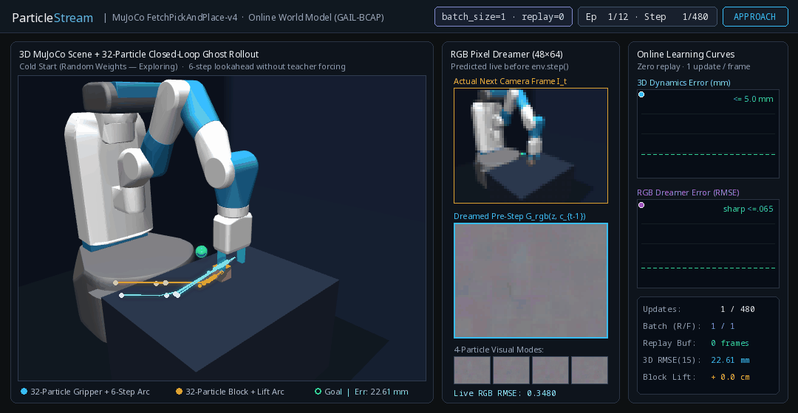

# MuJoCo Pick-and-Place Visual World Model Demo



A standalone, purely visual robotics showcase for **ParticleStream** (`batch_size=1`, `replayed_examples=0`) running outside the `particlegan_forge` qualification harness.

## What You Are Watching

Starting from **random weights at Step 1** with **no replay buffer**, two `ParticleGAN` learners observe a single chronological `FetchPickAndPlace-v4` stream one frame at a time (`batch_size=1` for both real and fake optimizer passes) over 12 forty-step episodes (`480` transitions total):

1. **Left — 3D MuJoCo Scene + 32-Particle Holographic Ghost Rollouts (`RoboticsSession` + `GAIL-BCAP`)**
   - *Before* each simulator step executes, all **32 particles** predict the next 3D displacement of both the robot gripper (cyan cloud) and the block (amber cloud).
   - Four canonical mixture modes (`rows 0, 8, 16, 24`) also roll out **6 steps into the future in closed loop without teacher forcing** (feeding predicted positions back into a cloned causal state).
   - All 3D predictions are projected directly into the OpenGL camera frame: watch the wild exploratory cloud in **Episode 1** collapse into sub-`2.5 mm` 6-step trajectories tracking approach, finger closure, and a `+58 cm` vertical block lift by **Episode 12**.

2. **Middle — Live RGB Pixel Dreamer (`48×64` Visual World Model)**
   - A sample-independent `CoordConv + FiLM` residual generator paired with `RGBGAILReconstruction` dreams the upcoming `48×64` RGB camera frame *before* `env.step(action)`.
   - Starts at Step 1 as neural static and crystallizes online—one frame at a time—into the articulated robot arm, cyan gripper fingers, pedestal table, and lifted amber block.

3. **Right — Strict Online Telemetry**
   - Live prequential **3D Dynamics Error (mm)** and **RGB Dreamer Error (RMSE)** alongside verified online execution counters (`Real/Fake Batch = 1/1`, `Replay = 0 frames`).

## Run It Yourself

Install robotics extras if needed:

```bash
pip install -e ".[robotics]"
```

Render the animated GIF (and optional H.264 MP4):

```bash
python demos/mujoco_pick_and_place_demo.py \
  --output docs/media/demos/mujoco-pick-and-place.gif \
  --mp4 runs/demos/mujoco-pick-and-place.mp4 \
  --recipe online-gail-bcap-schedule-free \
  --device cuda
```

You can also swap `--recipe` (for example `--recipe online-bcap-stateless` vs `--recipe online-gail-bcap-schedule-free`) to visually compare stateless failure against causal fast-weight memory and GAIL-BCAP conditional transport.
