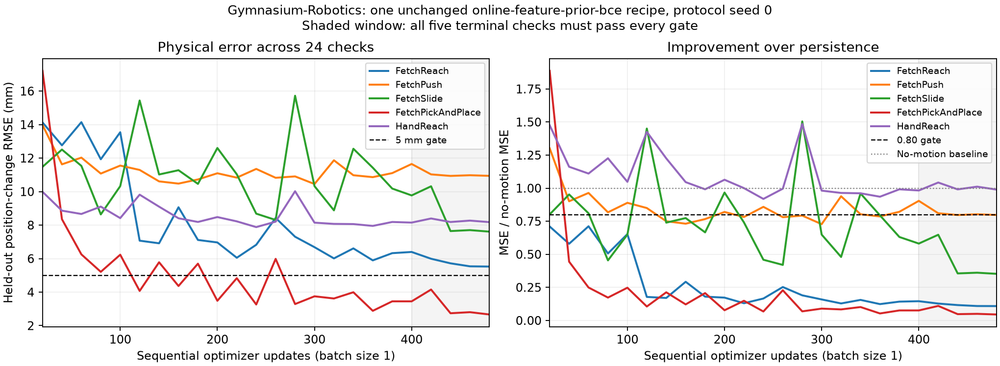

# Five Gymnasium-Robotics dynamics experiments

This expansion uses real MuJoCo transitions from `FetchReach-v4`, `FetchPush-v4`,
`FetchSlide-v4`, `FetchPickAndPlace-v4` and `HandReach-v3`. These are bounded,
action-conditioned, one-step world-model tests. Passing does not establish a
learned control policy, goal-reaching success, camera-image prediction or
closed-loop rollout. Rewards and simulator success flags are recorded only as
diagnostics and are never used by the learner or excitation policy.

## Measured results

The unchanged global recipe passes **0/5 robotics tests**. All five runs
complete 480 updates with finite parameters and outputs, zero replay and zero
evaluation RNG deviations. The existing required qualification stays **10/10**;
the complete stretch score is **1/10**, including the earlier token proof.

| Environment | Final error (mm) | Terminal error range (mm) | Final MSE / no motion | Final direction | Terminal checks | Result |
| --- | --- | --- | --- | --- | --- | --- |
| `FetchReach-v4` | 5.53 | 5.53–6.40 | 0.109 | 95.8% | 0/5 | **FAIL** · [goal.gif](gifs/online-feature-prior-bce_seq_robotics_fetch_reach.gif) |
| `FetchPush-v4` | 10.94 | 10.94–11.65 | 0.798 | 74.4% | 0/5 | **FAIL** · [goal.gif](gifs/online-feature-prior-bce_seq_robotics_fetch_push.gif) |
| `FetchSlide-v4` | 7.61 | 7.61–10.32 | 0.353 | 77.5% | 0/5 | **FAIL** · [goal.gif](gifs/online-feature-prior-bce_seq_robotics_fetch_slide.gif) |
| `FetchPickAndPlace-v4` | 2.67 | 2.67–4.15 | 0.045 | 84.2% | 4/5 | **FAIL** · [goal.gif](gifs/online-feature-prior-bce_seq_robotics_fetch_pick_and_place.gif) |
| `HandReach-v3` | 8.18 | 8.15–8.40 | 0.989 | 58.9% | 0/5 | **FAIL** · [goal.gif](gifs/online-feature-prior-bce_seq_robotics_hand_reach.gif) |



Reach learns useful kinematics: its final MSE is 89.1% lower than no motion,
and direction accuracy is 95.8%. Its terminal error remains 5.53–6.40 mm, so
every terminal check misses the 5 mm gate. Push remains weak on object motion:
final gripper error is 5.97 mm, versus 14.27 mm for the object. Slide improves
over persistence but never meets the terminal physical-error gate.

PickAndPlace has the lowest final error (2.67 mm) and passes every error,
relative-MSE and finite-output gate in the terminal window. At update 420,
moving-coordinate direction accuracy falls to 66.7%, so only four checks pass.
HandReach stays near persistence (8.18 mm versus 8.22 mm), with 58.9% direction
accuracy. A low final pixel loss would not establish either of these missing
physical capabilities.

The five current attempts use 2,400 optimizer updates, 7,200 counted arrivals,
2,400 live serving forwards and 7,680 checkpoint generator forwards; every
model forward has batch size one. Their summed task wall time is **165.12 s**,
including setup, evaluation and rendering. Checkpoint evaluation accounts for
**35.20 s**; the largest recorded CUDA allocation peak is **9.45 MiB**.
These costs describe the final cohort; the superseded encoding attempts below
are additional work and are not counted as completed runs in this cohort.

## Interpretation and recommendation

Keep all five as stretch tests and retain the existing global recipe as the
baseline. Do not promote PickAndPlace on a final-check success or relax the
five-check rule. The gap between useful reaching/lifting predictions and weak
Push/HandReach results makes continuous state/action conditioning and stable
motion direction the next useful global ablation. Declare one complete recipe
delta and apply it to all five tasks, retaining these physical gates and
fixed budgets. These measurements alone cannot isolate whether context
compression, conditional-prior capacity or the image reconstruction objective
causes the failures; increasing budgets or tuning each task would not answer
that question.

The finite held-out episodes, one-step horizon and fixed excitation policies
limit the conclusion. These results establish runnable robot dynamics tests,
not robust task solving or arbitrary control-policy coverage. All five oracle
controls pass and all twenty destructive controls fail. Receipt, trace and GIF
hashes, 24 frames per GIF, shared recipe identity, optimizer batch sizes, target
cleanup and preserved required qualification were independently checked.
Regression coverage is **510 unique passing tests**: the final suite process
received SIGTERM after 396 passes, then all 115 resumed tests passed with one
overlap. Workspace validation also passes for 20 tasks and 44 candidates.
Machine-readable measurements are in [robotics-audit.json](robotics-audit.json).

## Frozen protocol

- One global candidate: `online-feature-prior-bce`; recipe delta `{}` for all five.
  The generator, critic, optimizer, learned feature prior and causal memory
  retain the existing recipe and 8×8 coordinate-raster architecture.
- Protocol seed `0`, named initialization/data/prior/noise/evaluation streams.
  Each simulator reset receives a draw from its split's named stream; these
  episode resets are not alternate experiment seeds.
- Each task trains 480 chronological transitions: twelve 40-step episodes.
  Five tasks run sequentially: 2,400 optimizer updates in total. Real and fake
  batches are one, with no replay or gradient accumulation.
- Before each transition, the full current state (10/25/63 coordinates) arrives
  as `0.5 + 0.5*tanh(state)`, then the chosen action (4/20 coordinates) arrives
  as `0.5 + 0.5*action`. Both fit their separate 64-value frames without
  truncation. Observation memory resets between independent transition pairs;
  learned weights, feature statistics and optimizer state persist.
- Serving completes before `env.step(action)` reveals the target. One later
  target arrival trains once against the saved state/action context. Targets
  never enter observation memory. There are 960 source-only arrivals and 480
  target arrivals per task.
- Targets are gripper displacement for Reach, gripper plus object displacement
  for Push/Slide/PickAndPlace, and all five fingertip displacements for HandReach.
  Coordinates in metres repeat across the 64 target pixels, encoded as
  `0.5 + atan(displacement/0.1)/pi`. The inverse is
  `0.1*tan(pi*(code-0.5))`; 0.1 m sets the curvature, not a hard limit. This
  handles finite fast-contact motion without clipping. Decoding averages only
  fixed repeat slots before inversion, with no target snapping. Raw codes must
  lie strictly between zero and one.
- Fixed task-owned excitation uses uniform actions for Reach/HandReach;
  approach/contact/push phases for Push/Slide; approach/close/lift phases for
  PickAndPlace. This collection policy is not trained. No policy search occurs.
- Four separate evaluation-only episodes supply sixteen transitions, at steps
  7, 17, 27 and 37. They are generated once from the named evaluation stream,
  never optimized, and reused at all 24 checkpoints. Four clean latent centres
  (rows 0/8/16/24) are scored independently for every case, without best-of-N
  selection. This is a finite held-out set, not a generalization guarantee.

## Numerical gates and controls

All five terminal checks (updates 400, 420, 440, 460, 480) must meet every gate:

| Metric | Gate | Meaning |
| --- | --- | --- |
| `position_delta_rmse_m` | `<= 0.005` | At most 5 mm RMS position-change error |
| `relative_mse` | `<= 0.80` | At least 20% lower MSE than predicting no motion |
| `moving_direction_accuracy` | `>= 0.75` | Correct sign on coordinates moving at least 1 mm |
| `finite_fraction` | `== 1` | Every raw prediction finite and in its declared range |

The production scorer must pass the exact simulator-target oracle and fail
persistence, reversed motion, shuffled targets and an opposite-action oracle.
The last control restores MuJoCo's complete integration state and simulates
the opposite action in the evaluation-only environment. The observed
no-motion baseline RMS spans 8.22–16.76 mm; object RMS spans 12.55–14.86 mm,
so the manipulation probes include real object motion. These are data/control
measurements before training, not learned-model results.

All five tests are Tier 2 `stretch` in view 10. Views 8 and 9 are archived byte-for-byte;
the ten required toy tasks and five minimal probe declarations remain intact.
The only generated leaderboard remains [technique-inventory.md](technique-inventory.md).

## Reproduction and evidence

```sh
uv pip install --python .venv/bin/python -e '.[dev,robotics]'
.venv/bin/particlestream bootstrap
.venv/bin/particlestream robotics --controls-only
.venv/bin/particlestream robotics --device cuda
tail -F runs/forge/events.jsonl
```

Dependencies are pinned to Gymnasium 1.4.0, Gymnasium-Robotics 1.4.2 and
MuJoCo 3.3.7, alongside ParticleGAN/Forge 0.9.7. Receipts include resolved recipe,
simulator versions, controls, named reset seeds, compute counts, source hashes,
and a SHA256-bound simulator trace under `reports/forge/traces/`. Training GIFs
show actual checkpoint predictions and targets as coordinate rasters; they are
not rendered camera reconstructions. Full traces also remain in each run folder.


## Superseded encoding attempt

The initial affine encoding could represent only ±0.10 m of motion per step.
Reach and Push completed as FAIL, then a real fast-puck Slide transition
exceeded the range and stopped that run as INVALID. The unchanged source,
declarations and available evidence are preserved in
[the affine-v1 cohort](cohorts/robotics-affine-v1/README.md). The replacement
changes only the shared task-owned target encoding, followed by five fresh runs.
Recipe delta remains `{}`; physical gates, splits, policies and budgets stay fixed.

Environment definitions: [Fetch](https://robotics.farama.org/envs/fetch/),
[HandReach](https://robotics.farama.org/envs/shadow_dexterous_hand/reach/).
